# AI Code Review 控制台 · 功能介绍

> 本文是 AI Code Review 控制台的功能导览。文中所有界面截图取自**本地真实运行的控制台**，
> 演示数据由 `scripts/seed-demo.sql` 一次性生成——仓库名统一替换为 `acme/*` 示例，
> 提交者统一为 `ci-bot` 等机器人账号，**不含任何真实代码、客户信息或内网地址**。

| 项 | 值 |
|---|---|
| 截图采集 | 2026-10，本地环境实拍（1920×1080） |
| 产品形态 | Docker Compose，控制台与后端分离部署 |
| 支持平台 | **8 个**：GitHub、GitLab、Gitea、Forgejo、Gitee、GitCode、腾讯工蜂、Gerrit |
| 审查引擎 | OCR 多智能体（默认）/ Argus 外部引擎 |
| 数据来源 | `scripts/seed-demo.sql`（合成数据，可一键重置） |

---

## 一、它是什么

**把「代码评审」从人工约定变成可追溯的合并门禁。**

三件事串成一条闭环：

1. **触发**：8 个 Git 平台的 webhook 事件，或控制台 / API 手工发起；
2. **审查**：多 Agent（安全 / 后端 / 性能 / Rust / C / 前端 …）并行审查 → 聚合讨论 → 综合裁决，
   产出带定位（文件:行）与代码证据的问题清单；
3. **落地**：问题以行内评论 + 总结写回 PR/MR，并在同一 commit 上写一条 commit status
   （context = `review-service/gate`）——**这一条就是分支保护里的「必需检查」**。

于是「能不能合并」不再取决于谁记得去看评论，而由平台上的一个红/绿状态决定。

---

## 二、多平台接入

| 平台 | 接入方式 | 说明 |
|---|---|---|
| GitHub | go-git-platform SDK | webhook 事件、行内评论、commit status 全部打通 |
| GitLab | 同上 | 支持嵌套组仓库（`group/subgroup/project`） |
| Gitea / Forgejo | 同上 | 私有化部署常见 |
| Gitee | 同上 | |
| GitCode | 同上 | |
| 腾讯工蜂 | 同上 | |
| **Gerrit** | **独立 go-gerrit 客户端** | 见下 |

### Gerrit 为什么是例外

Gerrit **不在 go-git-platform SDK 的 backend 列表里**。因此：

- 平台注册走 `usesSDKBackend()` 的独立分支——不创建 SDK provider，
  而是直接建立 Gerrit 客户端并登记配置（clone URL / token / SkipTLS 都从这份配置读）；
- diff 不走 API，**由 git 计算**（Gerrit 的 change 语义与 PR/MR 不同）；
- webhook 用 Gerrit 自己的事件结构归一化；
- 评审意见以 **Review 标签 + 行内评论** 写回。

结果是：**clone / webhook / 审查 / 回写全链路都通**，而不是"文档写了但配不进去"。

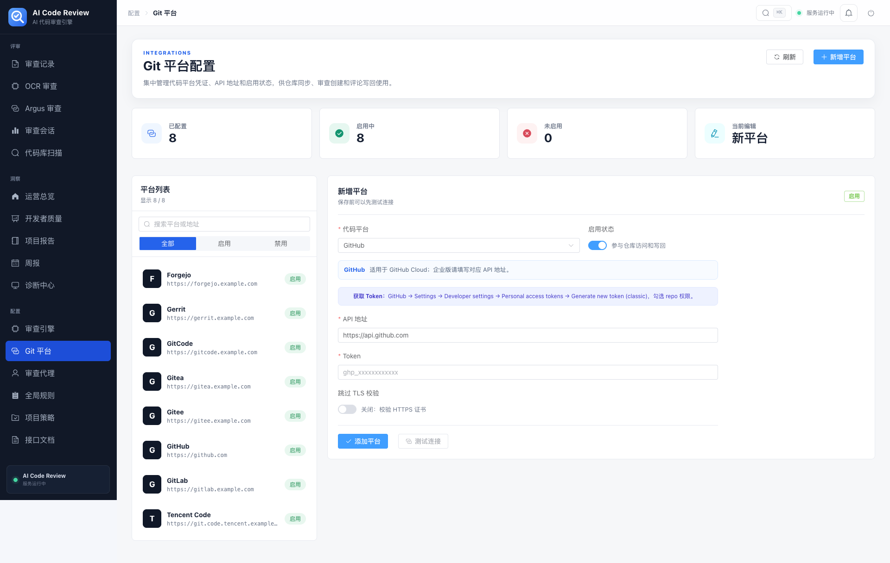

配置页给出每个平台的取 Token 指引（Gerrit 填「用户名:HTTP密码」），
支持「先测连接再保存」，列表顶部直接显示**已配置 / 启用中 / 平台总数**。

---

## 三、部署形态

| 组件 | 说明 | 默认端口 |
|---|---|---|
| `review-service` | 主服务：HTTP API + 评审 worker + 定时任务 | `8080` |
| `mcp-server` | MCP 端点：让外部 Agent 以工具方式发起评审 | `8082` |
| `review-frontend` | Web 控制台（Vue 3 + Element Plus） | `80` |
| Argus | 外部审查引擎（可选，异步回报模式） | `8899` |

两个审查引擎可按项目或单次评审切换：

- **OCR 引擎**（默认）：内置在主服务里的多 Agent 工作流，直接经 LLM 网关调用模型；
- **Argus 引擎**：独立容器，异步回报，与 OCR 互为补充。

> 注：OCR 二进制仍随镜像分发，用于**代码库扫描**与单 Agent 执行模式。

---

## 四、核心功能逐屏介绍

### 4.1 登录与访问鉴权

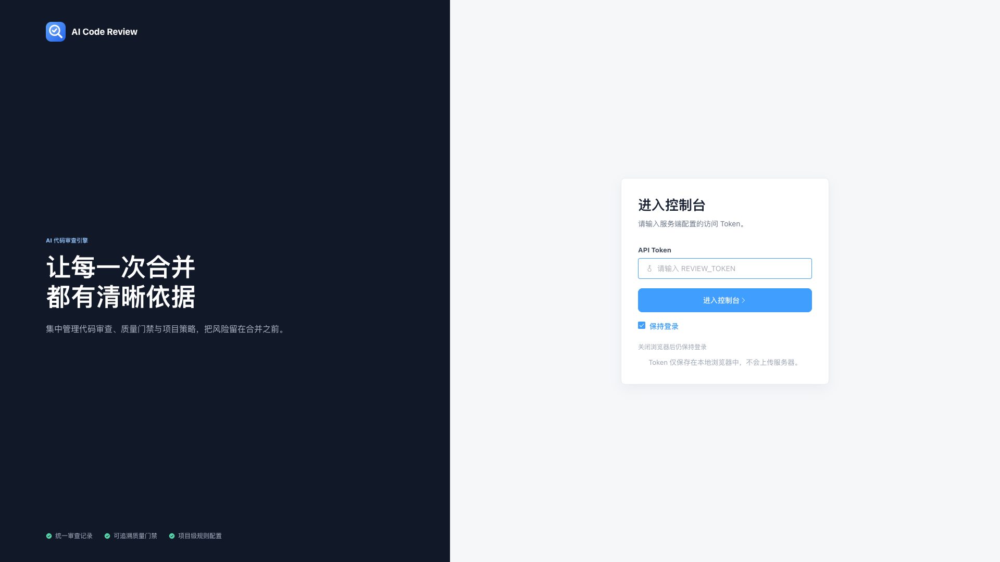

控制台是**单 Token 鉴权**：所有 API 走 `Authorization: Bearer <REVIEW_TOKEN>`。
Token 只存在浏览器本地（localStorage / sessionStorage），不上传服务端。
未带 Token 访问受保护端点返回 `401`。

### 4.2 运营总览（工作台）

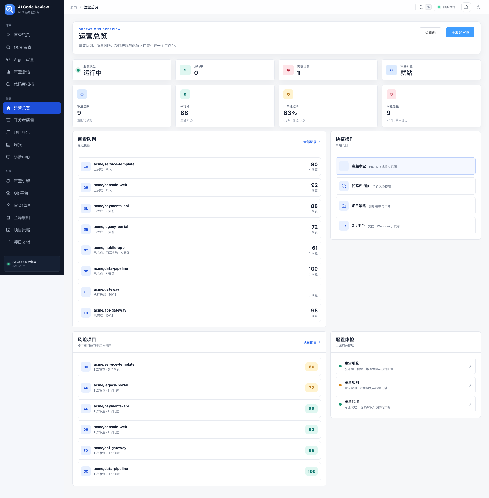

一屏回答四个问题：**服务活着吗 / 有没有卡住的任务 / 质量水位如何 / 该管哪个项目**。

- **服务状态**：运行中任务数、失败任务数、审查引擎是否就绪（探活结果）；
- **核心指标**：审查总数、平均分、门禁通过率、问题总量；
- **审查队列**：正在执行的评审，带阶段与百分比；
- **风险项目**：按「严重问题数 + 平均分」排序，点进去就是该项目的历史报告。

### 4.3 审查记录

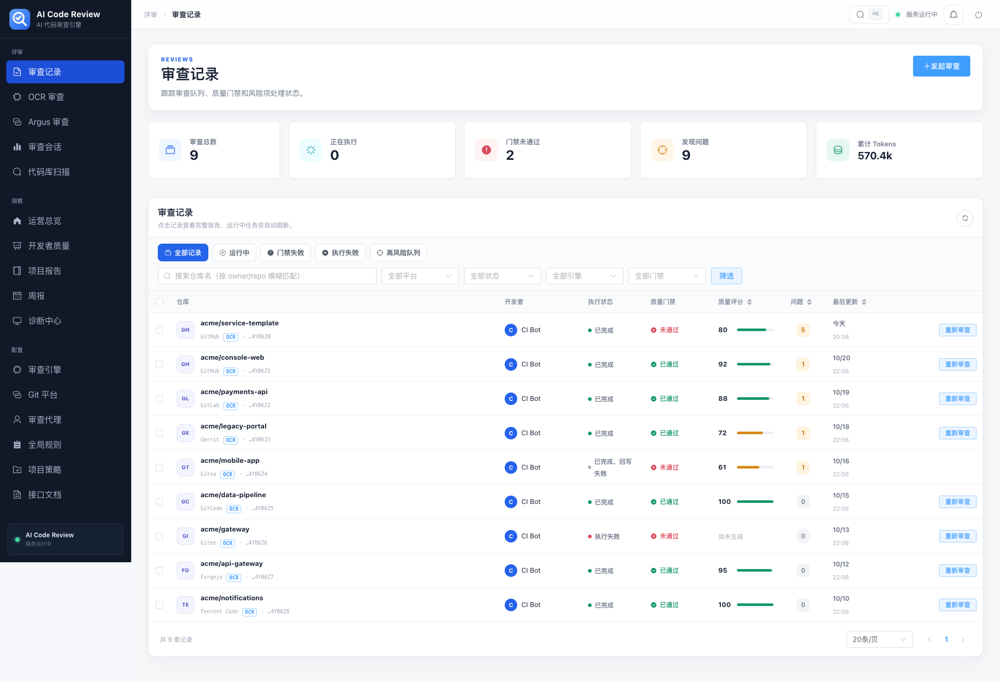

全部评审的统一入口。每条记录直接显示**门禁结论**（通过 / 未通过 / 失败 / 进行中）、评分、
问题数与归属作者——**不用点进去才知道结果**。仓库名后还带**平台徽标**，
一眼能看出这批评审分别来自哪些 Git 平台。

- **快捷视图**：全部记录 / 运行中 / 门禁失败 / 执行失败 / 高风险队列；
- **检索与排序**：按 `owner/repo` 模糊搜索；可按质量评分、问题数、最后更新时间排序；
- **逐条操作**：对历史记录直接「重新审查」。

### 4.4 审查详情：一次评审的完整证据链

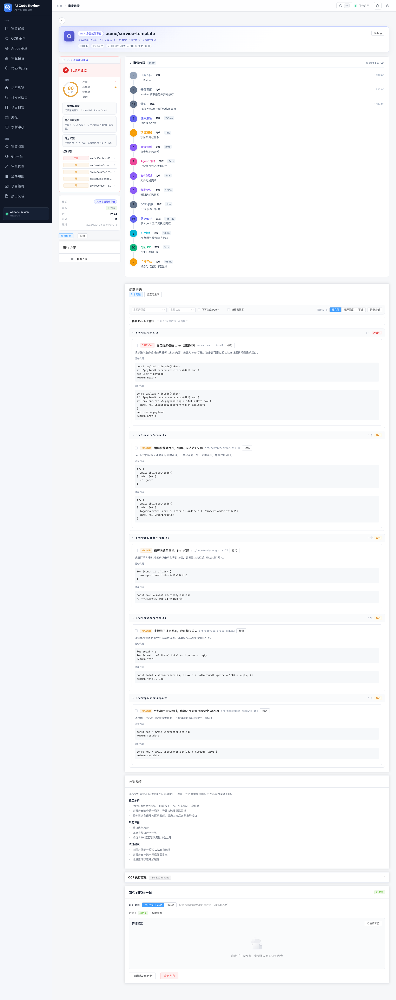

这是本系统信息密度最高的页面，也是「结论可追溯」的落点。分五层看：

**① 结论层**：门禁状态 + 评分（`80 / 100`）+ 分级问题数（严重 / 高风险 / 中风险 / 提示），
并给出**为什么没通过**（`门禁策略触发：5 should-fix items found`）与**评分怎么扣的**
（`严重问题 -7 分`、`高风险问题 -13 分`），最后是「优先修复」——直接点文件:行跳转。

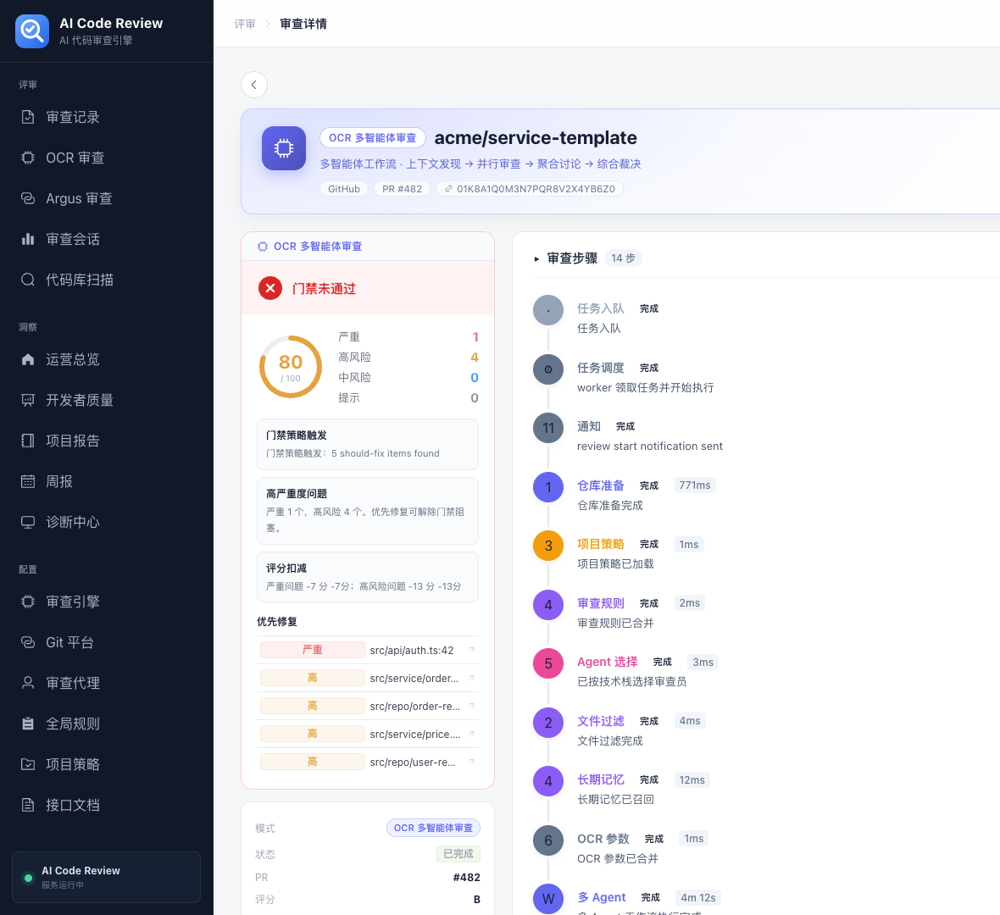

**② 过程层**：左栏「执行历史」逐阶段列出事件与时间戳（入队 → worker 领取 → 通知 →
仓库准备 → 文件过滤 → 项目策略 → 审查规则 → 长期记忆 → Agent 选择 → OCR 参数 →
多 Agent 工作流 → AI 判断 → 写回 PR → 门禁评估，共 **14 步**），每步带耗时。

**③ 问题层**（下屏）：每条问题带严重度、文件:行、问题描述、**现有代码片段**、可否生成 Patch，
支持按严重度/状态筛选、按文件或严重度分组。

**④ 裁决层**：综合分析（变更概述 + 风险评估 + 改进建议），是多 Agent 讨论收敛后的结论，
不是单点意见。

**⑤ 落地层**：`OCR 执行信息`（审查文件数、评论数、token 用量、耗时、覆盖范围、风险密度）+
`发布到代码平台`（评论范围：行内评论+总结 / 仅总结；成功/降级条数；评论预览；可重新发布）。

> 实测一个「写回降级」的样例：评审期间分支被推了新提交导致 head 漂移，
> 系统**不丢弃结论**，而是降级为「仅总结」发布，并在执行历史里明确记录
> `writeback degraded (stale): head c20089d4 -> 3efed360`。

### 4.5 审查引擎设置

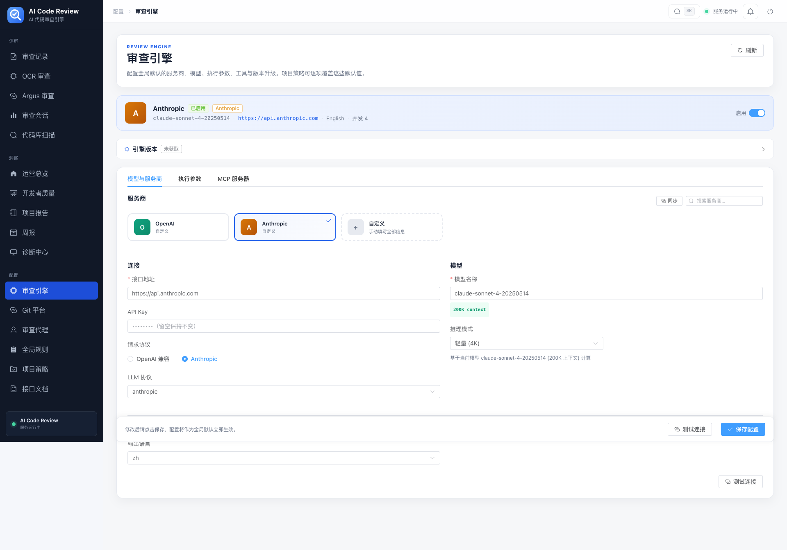

全局默认的 **服务商 / 模型 / 执行参数 / 工具 / 版本** 都在这里，项目策略可逐项覆盖：

- 服务商（OpenAI 兼容 / Anthropic / 自定义）、模型名、推理模式、推理预算 tokens；
- **接口地址与 API Key**：Key 只在保存时写入，读取时一律返回掩码（`••••• 留空保持不变`）；
- 引擎版本与平台，支持在线升级；
- MCP 服务器配置（供 Agent 调用外部工具）。

### 4.6 审查代理（审查员能力库）

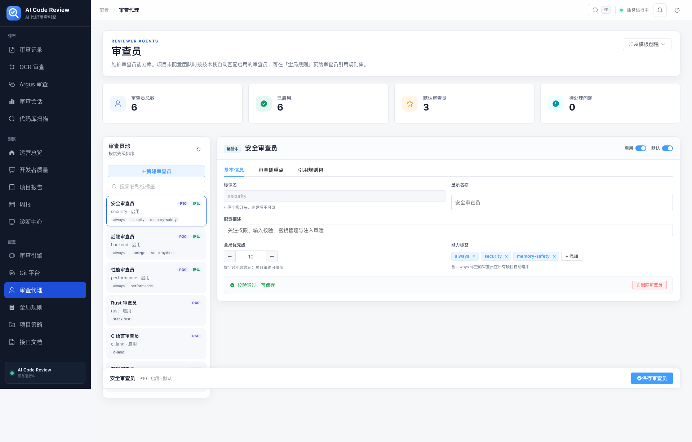

「谁在审、按什么标准审」的可配置层。页面定位写得很清楚：**项目未配置团队时，按技术栈自动
匹配启用的审查员**。

- **审查员池**（按优先级排序）：安全 / 后端 / Rust / C 语言 / 性能 / 前端…，
  每个都标了启用状态与是否默认；
- **能力标签**就是匹配依据：`stack:go` / `stack:python` / `stack:java` / `stack:rust` /
  `stack:node` / `c-lang` / `memory-safety` / `performance` 等；
  **带 `always` 标签的审查员在所有项目自动选中**（安全与性能是默认审查员）；
- **每个审查员可配**：标识名、显示名、职责描述、全局优先级（数值越小越靠前，项目策略可覆盖）、
  能力标签、审查侧重点、**引用规则包**（规则与审查员解耦，便于跨项目复用）。

### 4.7 全局规则

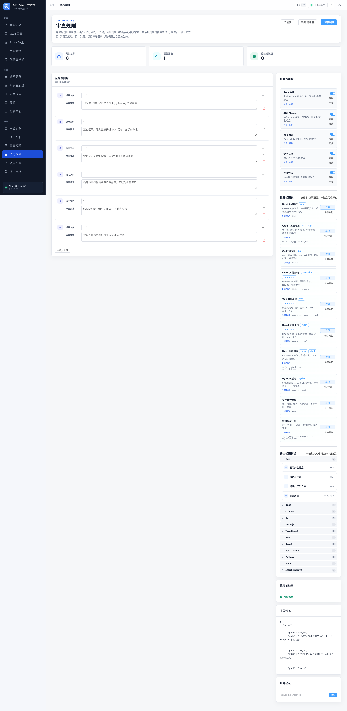

跨仓库生效的通用规则集。每条规则带**严重级别**（critical / major / minor / info）、
标题与判定描述，可单独启停。规则与审查员解耦：规则包可以被多个审查员引用，
也允许项目策略追加仓库专属规则。

### 4.8 项目策略工作台

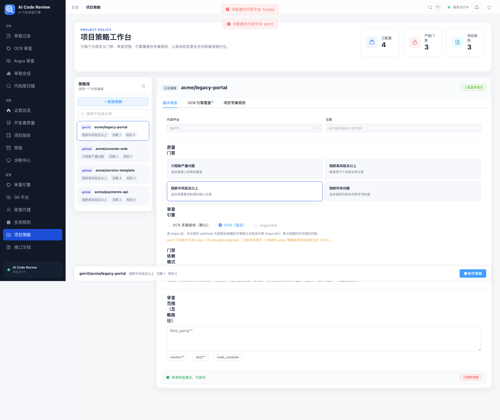

按**仓库**维度定策略——「为每个仓库定义门禁、审查范围、引擎覆盖和专属规则」。

- **策略库**：按平台/仓库检索，列表直接标出每个仓库的门禁档位、忽略路径数、专属规则数；
- **质量门禁**四档：只阻断严重问题 / 阻断高风险及以上（推荐给大多数业务仓库）/
  阻断中风险及以上 / 阻断所有问题；
- **审查引擎**：OCR 多智能体（默认）/ OCR（显式）/ Argus Bot；
- **门禁依赖模式**三档：跟随默认（OCR 强、Argus 弱）/ 强依赖 / 弱依赖。
  强依赖 = 评审未过或执行失败在 PR 上标红，**可配为分支保护的必需检查**；
  弱依赖 = 任何结果仅以 `success` 留痕（描述带「弱门禁」），不阻塞自动合并；
- **审查范围（忽略路径）**：支持多行 glob（`vendor/**`、`dist/**`、`node_modules` 等）；
- 另有「配置审查员」入口，可为单个项目指定参与评审的审查员。

### 4.9 项目报告（洞察）

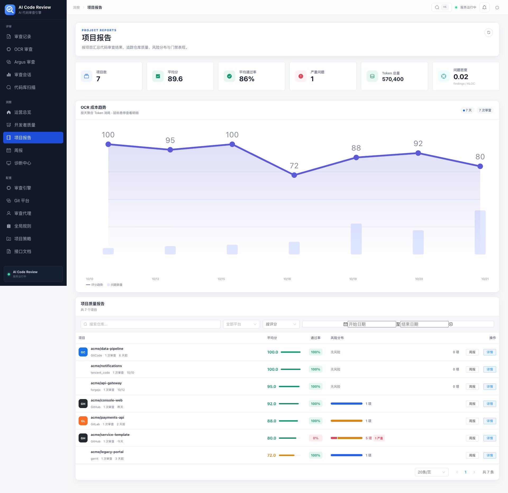

以项目为单位的历史体检：

- **汇总指标**：项目数、平均分、平均通过率、严重问题数、**Token 总量**、问题密度
  （Token 总量这一项很实用——它把「质量」和「花了多少钱」放在同一张表里看）；
- **趋势图**：审查分数随时间的变化；
- **项目明细表**：项目 / 平均分 / 通过率 / 风险分布 / 问题数 / 操作，可下钻到单次评审；
- 配合「开发者质量」「周报」形成周期性质量运营视图。

### 4.10 诊断中心

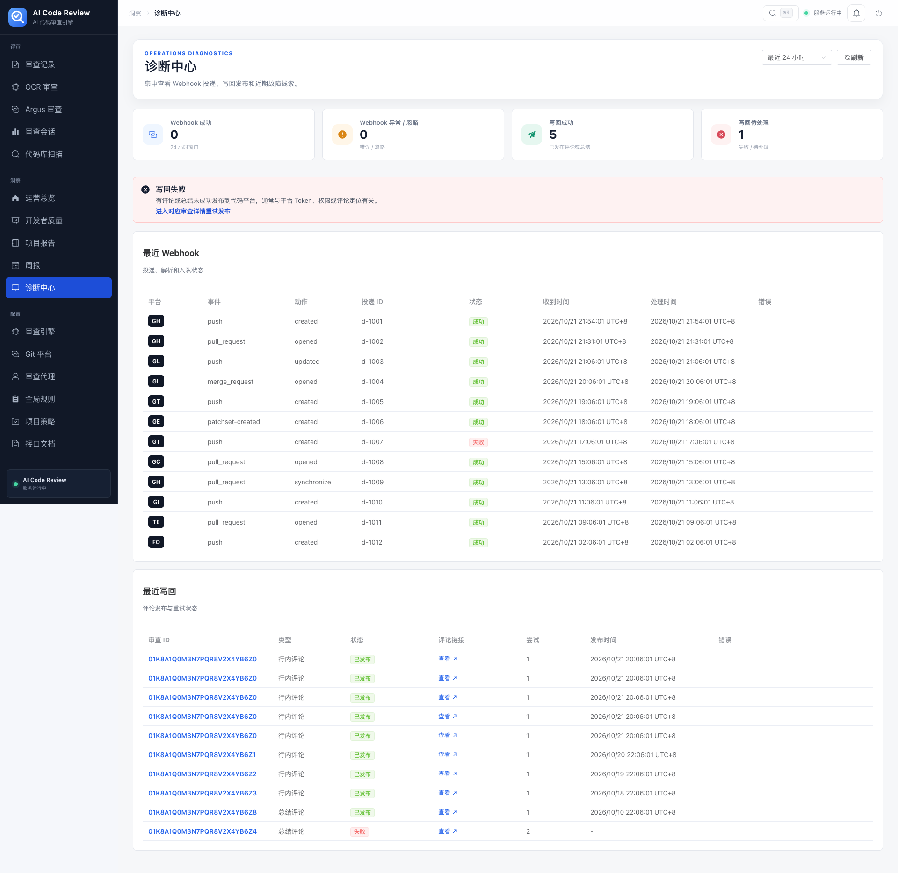

面向运维的自助排查台：

- **Webhook 投递**：成功 / 异常 / 待处理计数，最近投递明细（事件类型、动作、状态、耗时、错误）；
- **写回记录**：逐条 review 的评论发布结果（`summary` / `inline` 类型与 `published` 状态）；
- 可按时间窗口筛选，用于回答「用户说没收到评论，昨晚到底发生了什么」。

### 4.11 其余页面

| 页面 | 截图 | 说明 |
|---|---|---|
| 审查会话 | 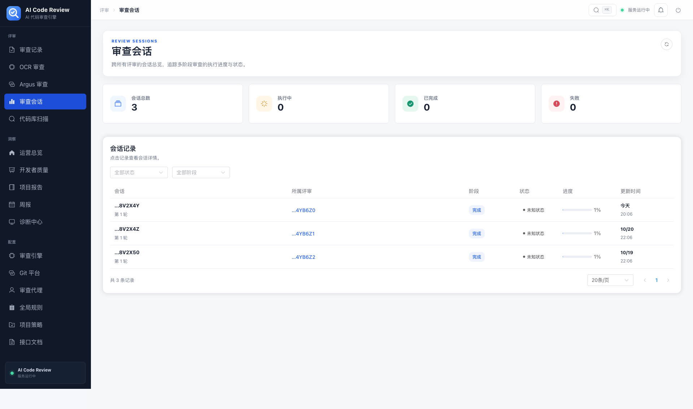 | 多轮评审会话与 Agent 讨论过程 |
| 开发者质量 | 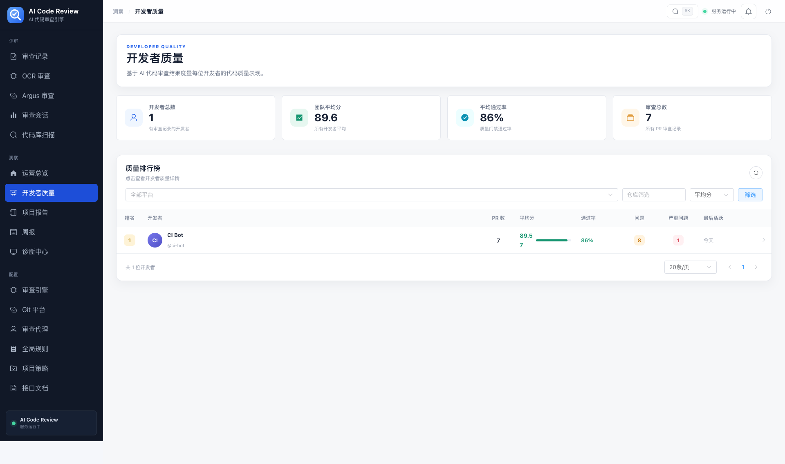 | 按提交者维度的质量画像 |
| 周报 | 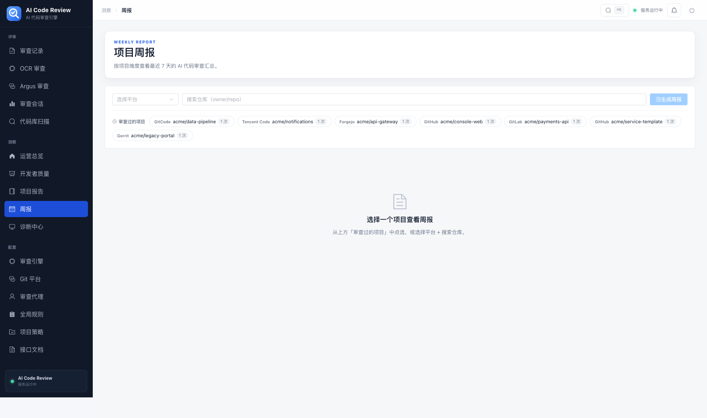 | 项目级周期性评审汇总 |
| 代码库扫描 | 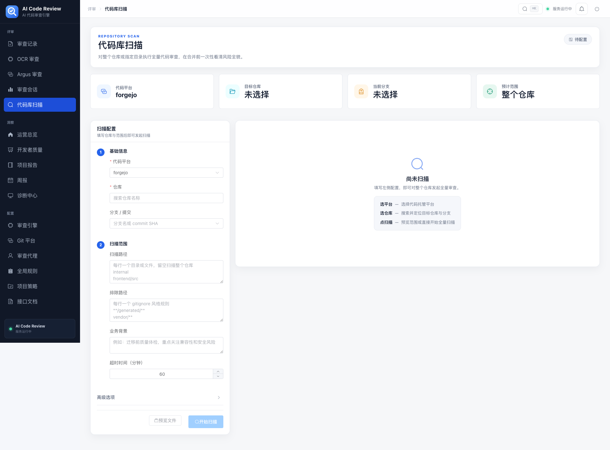 | 不依赖 PR 的全仓库扫描 |

---

## 五、一次评审的全链路

| # | 阶段 | 做什么 | 失败时 |
|---|---|---|---|
| 1 | 入队 | 幂等键去重，落库为 `queued` | — |
| 2 | worker 领取 | `FOR UPDATE SKIP LOCKED` 领取，多副本安全 | 残留 `running` 由心跳任务回收重排 |
| 3 | 通知 | 发 commit status `pending` + PR 起始评论 | 失败仅告警，不阻断 |
| 4 | 仓库准备 | 按平台基地址 clone（出站防护：host 必须与配置一致、拒回环、拒路径穿越） | 失败即门禁失败 |
| 5 | 文件过滤 | 按忽略路径裁掉不该审的文件 | — |
| 6 | 项目策略 | 合并项目级规则与忽略路径 | — |
| 7 | 审查规则 | 全局规则 + 项目规则 + 包规则合并 | — |
| 8 | 长期记忆 | 召回该仓库的历史问题与约定 | — |
| 9 | Agent 选择 | 按变更文件的技术栈匹配审查员 | 无匹配则回落默认审查员 |
| 10 | 引擎参数 | 合并模型、并发、token 预算、门禁模式 | — |
| 11 | 多 Agent 工作流 | 上下文发现 → 并行审查 → 聚合讨论 → 综合裁决 | 可重试错误指数退避重试；不可重试直接失败 |
| 12 | 写回 PR | 行内评论 + 总结；head 漂移则降级为仅总结 | 降级可见，不静默丢弃 |
| 13 | 门禁评估 | 生成评分、分级问题、门禁结论 | — |
| 14 | 状态落盘 | 写 commit status 终态 | — |

**门禁与 commit status**：门禁结论写在该 commit 上、context 为 `review-service/gate` 的
commit status 上，分支保护勾选它即可实现「检查通过才允许合并」。状态写入会先按平台词表对齐
（GitLab 没有 `error` 这个词，评审失败落成 `failed` 而不是看起来像「还在跑」的 `pending`），
并跳过「重复写同一非终态」这种 GitLab 拒绝的转移。

---

## 六、几个值得知道的设计取舍

- **配置以严格模式加载**：`etc/config-{env}.yaml` 里出现未知键（拼错、或键已废弃）会让服务
  **拒绝启动**并指出出错路径、该层合法键与拼写建议，而不是静默忽略。代价是**升级前要先清理旧配置**。
- **重复写同一非终态会被平台拒绝**：GitLab 的 commit status 状态机不允许 `pending → pending`，
  所以写非终态前先读当前值，已是同态就跳过；终态则可以覆盖（复审要能改结论）。
- **嵌套组仓库**：GitLab 的 `group/subgroup/project` 形式，owner 天然含 `/`。
  出站防护必须**逐段**校验路径，否则这类仓库会被整体误杀。
- **并发回源合并**：平台列表、OCR 设置等本地缓存过期瞬间，用 singleflight 合并回源，
  避免对平台 API 放大请求。
- **失败不静默**：回写降级、Agent 失败、门禁未过，都能在界面上看到明确状态与原因。
- **Gerrit 不进 SDK provider 表**：它的配置、客户端、clone URL、diff、webhook、回写各走各的路径，
  但对外表现得和其他平台一样——这正是 `usesSDKBackend()` 这一个分支存在的意义。

---

## 七、运维要点

- **部署**：本机交叉编译（`CGO_ENABLED=0 GOOS=linux GOARCH=amd64`）→ 产出静态二进制与
  前端 dist → 构建镜像 → 起容器。离线环境可用增量镜像：
  `FROM` 现网镜像 + `COPY` 新二进制（继承 OCR 二进制与 npm 包，全程零网络）。
- **回滚**：镜像打 `rollback-<日期>` tag + 配置文件备份，回滚 = 改回 tag 再起。
- **探活**：`GET /health`（无需认证）；MCP 端点需带 Bearer 与 Content-Type 的 `initialize` 请求。
- **排查入口**：先看控制台「诊断中心」的 webhook/写回明细，再看评审详情页的阶段时间戳，
  最后才去翻容器日志。
- **本地起一套做演示**：`scripts/seed-demo.sql` 一键灌入合成演示数据，
  起后端与前端后即可复现本文的全部截图（1920 宽整页图）。

---

## 八、已知限制

1. **commit status 平台差异**：各平台的 commit status 词表与状态机不同
   （GitLab 无 `error` 词、且禁止重复写同一非终态；GitHub 用 `failure` 而非 `failed`）。
   本服务已在平台适配层对齐，但**新增平台**时需要同步确认其词表。
2. **写回降级**：评审期间目标分支被推新提交时，评论会降级为「仅总结」发布
   （结论不丢，但行内评论不落到新提交上）。
3. **成本与质量的耦合**：多 Agent 审查的 token 消耗随变更规模线性增长。
   项目报告页提供 Token 总量视图，建议按项目设置并发与门禁档位来控制。
4. **Gerrit 单层 project**：形如 `my-project`（无 group 前缀）的仓库名在 clone 路径校验上
   仍需逐段拆分确认，`group/project` 形式无此问题。

---

## 关于截图数据

本文全部截图取自**本地运行的真实控制台**，数据来自 `scripts/seed-demo.sql`：

- **标识符**：仓库路径 → `acme/*` 示例名；评审 ID / commit SHA → 形状相同的合成值；
  提交者 → `ci-bot` 等机器人账号；平台地址 → `*.example.com` 通用域名；
- **评审内容**：问题清单、现有代码片段、风险评估与改进建议整体替换为一份**通用示例**
  （token 过期未校验 / 错误被吞 / N+1 查询 / 浮点金额精度 / 外部调用未设超时），
  并同步对齐了评分、扣分明细与问题计数——面板上显示的数字与列出的问题**自洽**；
- **系统自身已遮蔽**：LLM API Key 读取时返回掩码、平台 Token 为占位符。

界面结构、交互与文案均为**真实运行**的产品形态。

---

## 附录：截图清单

| 文件 | 页面 |
|---|---|
| `assets/screenshots/00-login.png` | 登录页 |
| `assets/screenshots/01-dashboard.png` | 运营总览 |
| `assets/screenshots/02-reviews-list.png` | 审查记录 |
| `assets/screenshots/03-review-detail.png` | 审查详情（全页） |
| `assets/screenshots/04-review-gate.png` | 审查详情 · 门禁与评分特写 |
| `assets/screenshots/05-settings-engine.png` | 审查引擎设置 |
| `assets/screenshots/06-settings-platforms.png` | Git 平台配置（8 个平台） |
| `assets/screenshots/07-settings-agents.png` | 审查代理 |
| `assets/screenshots/08-settings-rules.png` | 全局规则 |
| `assets/screenshots/09-settings-projects.png` | 项目策略工作台 |
| `assets/screenshots/10-project-reports.png` | 项目报告 |
| `assets/screenshots/11-diagnostics.png` | 诊断中心 |
| `assets/screenshots/12-sessions.png` | 审查会话 |
| `assets/screenshots/13-contributors.png` | 开发者质量 |
| `assets/screenshots/14-weekly-report.png` | 周报 |
| `assets/screenshots/15-scan.png` | 代码库扫描 |

重新采集：

```sh
# 1) 建库并灌演示数据（合成数据，可反复重置）
docker exec difftest-pg psql -U postgres -c "CREATE DATABASE ai_code_review_demo"
docker exec -i difftest-pg psql -U postgres -d ai_code_review_demo < scripts/seed-demo.sql
# 2) 起后端（连上面的库）与前端 dev server（:3000）
# 3) 用 Playwright 打开对应路由，整页截图（1920 宽）存入 docs/assets/screenshots/
```

> 宣传片的渲染工程（截图脚本、逐帧合成器、配音生成）属于**制作工具链，不随产品仓库发布**，
> 成片也不进仓库（根 `.gitignore` 已加 `*.mp4` 守卫）。
